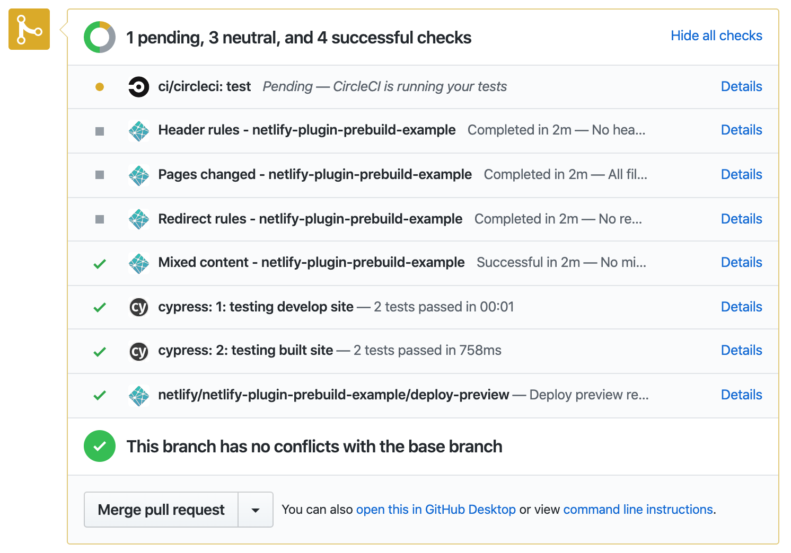

# netlify-plugin-cypress
[](https://circleci.com/gh/cypress-io/netlify-plugin-cypress/tree/master) [![renovate-app badge][renovate-badge]][renovate-app] [](https://dashboard.cypress.io/projects/ixroqc/runs)

> Run [Cypress](https://www.cypress.io) end-to-end tests as part of every Netlify build.

A successful build doesn't always mean a working site. A page can render blank, a route can 404, or a form can stop submitting, and the build log still shows green. This plugin runs your Cypress tests inside Netlify Build, so you find out whether the site *works*, not just whether it compiled.

With this plugin, you can:

- **Test every deploy automatically.** By default, we run your tests against the deploy preview, branch deploy, or production URL as soon as Netlify publishes it.
- **Block broken sites from going live.** Run tests before or after the build step, and Netlify stops the deploy if any test fails.
- **Skip the CI setup.** No separate pipeline, no extra YAML. Add a few lines to `netlify.toml` and you're done.
- **See results where you already look.** We post a pass/fail summary in the Netlify deploy log, and you can record runs to [Cypress Cloud](https://www.cypress.io/cloud) for screenshots, videos, and GitHub status checks.

## Contents

- [Quick start](#quick-start)
- [How it works](#how-it-works)
- [Recommended setup](#recommended-setup)
- [Choose when tests run](#choose-when-tests-run)
- [Configuration reference](#configuration-reference)
- [Recording to Cypress Cloud](#recording-to-cypress-cloud)
- [More examples](#more-examples)
- [Limitations](#limitations)
- [Upgrading from v1 to v2](#upgrading-from-v1-to-v2)
- [Debugging](#debugging)
- [Troubleshooting](#troubleshooting)

## Quick start

### Requirements

- Node.js 20.19.6 or later in your Netlify build
- Cypress installed as a dev dependency in your project, with at least one end-to-end spec

```shell
npm install --save-dev cypress
```

### Install the plugin

You can install the plugin in one of two ways.

**Option 1: From the Netlify UI.** Use the [direct in-app installation link](https://app.netlify.com/plugins/netlify-plugin-cypress/install) or find it in the [Netlify plugins directory](https://app.netlify.com/plugins).

**Option 2: In your repository.** Add the package as a dev dependency:

```shell
npm install --save-dev netlify-plugin-cypress
# or
yarn add -D netlify-plugin-cypress
```

Then add it to your [`netlify.toml` file](https://docs.netlify.com/configure-builds/file-based-configuration/):

```toml
[[plugins]]
  # runs Cypress tests against the deployed URL
  package = "netlify-plugin-cypress"
```

That's all you need. On your next deploy, the plugin tests the deployed site and reports the results in the deploy log. For faster builds, see the [recommended setup](#recommended-setup).

## How it works

Netlify Build runs plugins at fixed points around building and deploying your site. This plugin can run Cypress at three of them:

```
preBuild     ← optional: test a dev server, before the build
  build the site
postBuild    ← optional: test the built folder, before the deploy
  deploy the site
onSuccess    ← default: test the live deployed URL
```

| Step | What we test | Enabled by default? | If a test fails |
| --- | --- | --- | --- |
| `onSuccess` | The deployed URL (`DEPLOY_PRIME_URL`) | Yes | The plugin reports a failure, but **the site is already live** |
| `postBuild` | Your publish folder, served locally | No | The build fails and **Netlify doesn't deploy** |
| `preBuild` | A server you start, such as a dev server | No | The build fails and **Netlify doesn't deploy** |

We run Cypress through the [Cypress Module API](https://on.cypress.io/module-api) in headless mode. We use Chromium by default, which we install through [Puppeteer](https://github.com/puppeteer/puppeteer) and cache in `node_modules`.

### Important: the default step can't stop a deploy

The `onSuccess` step runs *after* Netlify publishes your site. That's how it can test the real URL, but it also means a failing test can't undo the deploy. To protect your site, choose one or more of these:

1. **Also run tests before the deploy.** Enable [`postBuild`](#test-the-built-site-postbuild) or [`preBuild`](#test-a-running-server-prebuild). A failure in either step fails the build, and Netlify keeps the previous deploy live.
2. **Add status checks to pull requests.** [Record to Cypress Cloud](#recording-to-cypress-cloud) and install the [Cypress GitHub integration](https://on.cypress.io/github-integration) (GitLab and Bitbucket are also supported). Failing tests then show up as failing checks on the pull request.
3. **Get notified fast.** Set up [Cypress Slack notifications](https://on.cypress.io/slack-integration) so you can roll back a broken production deploy quickly.

## Recommended setup

By default, Cypress installs its binary in your home folder, which Netlify doesn't cache between builds. Netlify *does* cache `node_modules`, so we recommend [storing the Cypress binary there](https://on.cypress.io/caching):

```toml
[build]
  command = "npm run build"
  publish = "build"

[build.environment]
  # store the Cypress binary in "node_modules" so Netlify caches it
  CYPRESS_CACHE_FOLDER = "./node_modules/CypressBinary"
  # set TERM for cleaner terminal output
  TERM = "xterm"
  # hide the long progress output from "npm install"
  CI = "1"

[[plugins]]
  # runs Cypress tests against the deployed URL
  package = "netlify-plugin-cypress"
```

The rest of the examples in this README leave out the `[build]` sections to stay short, but we suggest keeping these settings in your own config.

For a complete working project, see the [netlify-plugin-cypress-example](https://github.com/cypress-io/netlify-plugin-cypress-example) repo. For a step-by-step walkthrough, read [Test Sites Deployed To Netlify Using netlify-plugin-cypress](https://glebbahmutov.com/blog/test-netlify/).

## Choose when tests run

### Each step has its own settings

This is the part that most often trips people up: **every step reads only its own block of settings.**

- Settings directly under `[plugins.inputs]` apply **only** to the `onSuccess` step.
- Settings under `[plugins.inputs.postBuild]` apply **only** to `postBuild`.
- Settings under `[plugins.inputs.preBuild]` apply **only** to `preBuild`.

Nothing is shared between steps. If you want `postBuild` to use a custom `spec` or `configFile`, set it inside the `postBuild` block, even if you already set it under `[plugins.inputs]`.

### Test the deployed site (onSuccess)

This is the default, and the [quick start](#quick-start) config is all you need. We test the URL Netlify gives the build, which is the deploy preview, branch deploy, or production URL depending on the [deploy context](https://docs.netlify.com/site-deploys/overview/#deploy-contexts).

To turn it off, for example when you only want pre-deploy testing:

```toml
[[plugins]]
  package = "netlify-plugin-cypress"
  [plugins.inputs]
    enable = false
```

### Test the built site (postBuild)

After Netlify builds your site, we can serve the publish folder on `http://localhost:8080` and test it before anything deploys:

```toml
[[plugins]]
  package = "netlify-plugin-cypress"
  [plugins.inputs.postBuild]
    enable = true
```

Our built-in static server automatically resolves `.html` files. For example, with this publish folder:

```
public/
  index.html
  pages/
    about.html
```

Both of these visits work:

```js
cy.visit('/')
cy.visit('/pages/about') // serves pages/about.html
```

The built-in server doesn't run Netlify redirects or Netlify Functions. If your tests depend on them, [use the Netlify CLI](#test-redirects-and-functions-with-the-netlify-cli).

#### Single-page apps

If your app uses client-side routing, set `spa` so the server returns your index page for unknown routes like `/about`. This setting only works in the `postBuild` step.

```toml
[[plugins]]
  package = "netlify-plugin-cypress"
  [plugins.inputs.postBuild]
    enable = true
    # true uses "index.html"; you can also pass a different fallback file name
    spa = true
```

See [lws-spa](https://github.com/lwsjs/spa) for how the fallback works, and [tests/routing](./tests/routing) for an example.

#### Use your own server

To serve the built site with your own command instead, set `start` and `wait-on`. We start the command, wait for the URL to respond, and run the tests against that URL.

```toml
[[plugins]]
  package = "netlify-plugin-cypress"
  [plugins.inputs.postBuild]
    enable = true
    start = "npx serve public"
    wait-on = "http://localhost:3000"
    wait-on-timeout = "30" # seconds
```

Always set `wait-on` together with `start`. Without it, we don't know your server's address and point Cypress at `http://localhost:8080`.

### Test a running server (preBuild)

Before Netlify builds your site, we can start a server, such as your dev server, and test it:

```toml
[[plugins]]
  package = "netlify-plugin-cypress"
  [plugins.inputs.preBuild]
    enable = true
    start = "npm start"
    wait-on = "http://localhost:3000"
    wait-on-timeout = "30" # seconds
```

`wait-on` is also the URL Cypress tests, so `preBuild` needs both `start` and `wait-on`. See the [netlify-plugin-prebuild-example](https://github.com/cypress-io/netlify-plugin-prebuild-example) repo.

### Test redirects and functions with the Netlify CLI

If your site relies on Netlify redirects or Netlify Functions, start the [Netlify CLI](https://cli.netlify.com/) dev server during `preBuild` so your tests cover them too.

```shell
npm install --save-dev netlify-cli
```

```toml
[[plugins]]
  package = "netlify-plugin-cypress"
  [plugins.inputs.preBuild]
    enable = true
    start = "npx netlify dev --offline"
    wait-on = "http://localhost:8888"
```

For a full example, see [tests/test-netlify-dev](./tests/test-netlify-dev) and the [Testing Netlify Functions](https://glebbahmutov.com/blog/test-netlify/#testing-netlify-functions) section of the tutorial.

### Combine steps

You can turn on any combination. This config tests the dev server, then the built site, and skips the deployed URL:

```toml
[[plugins]]
  package = "netlify-plugin-cypress"

  # don't test the deployed URL
  [plugins.inputs]
    enable = false

  [plugins.inputs.preBuild]
    enable = true
    start = "npm start"
    wait-on = "http://localhost:3000"

  [plugins.inputs.postBuild]
    enable = true
    spa = true
```

## Configuration reference

Remember that each step reads only its own block. See [Each step has its own settings](#each-step-has-its-own-settings).

| Setting | What it does | Default | `onSuccess` | `postBuild` | `preBuild` |
| --- | --- | --- | :---: | :---: | :---: |
| `enable` | Turns testing on for this step | `true` for `onSuccess`, `false` otherwise | ✓ | ✓ | ✓ |
| `browser` | `chromium` or `electron` | `chromium` | ✓ | ✓ | ✓ |
| `spec` | Spec file or glob to run, like `cypress run --spec` | All specs | ✓ | ✓ | ✓ |
| `configFile` | Path to a Cypress config file | Cypress default | ✓ | ✓ | ✓ |
| `record` | Record the run to Cypress Cloud (needs `CYPRESS_RECORD_KEY`) | `false` | ✓ | ✓ | ✓ |
| `group` | Group name for a recorded run | The step name | ✓ | ✓ | ✓ |
| `tag` | Comma-separated tags for a recorded run | Netlify deploy context | ✓ | ✓ | ✓ |
| `start` | Command that starts a server | None | | ✓ | ✓ |
| `wait-on` | URL to wait for, and the URL Cypress tests | `http://localhost:8080` in `postBuild` | | ✓ | ✓ |
| `wait-on-timeout` | Seconds to wait for `wait-on` to respond | `60` | | ✓ | ✓ |
| `spa` | `true` or a fallback file name for client-side routing | None | | ✓ | |

### Examples

**Run only some specs:**

```toml
[[plugins]]
  package = "netlify-plugin-cypress"
  [plugins.inputs]
    spec = "cypress/e2e/smoke*.cy.js"
```

**Use the Electron browser that ships with Cypress:**

```toml
[[plugins]]
  package = "netlify-plugin-cypress"
  [plugins.inputs]
    browser = "electron"
```

If you only use Electron, you can also skip the Chromium download and save build time. See [Troubleshooting](#troubleshooting).

**Use a different Cypress config file:**

```toml
[[plugins]]
  package = "netlify-plugin-cypress"
  [plugins.inputs]
    configFile = "cypress.netlify.config.js"
```

See [tests/config-file](./tests/config-file) for an example that sets `configFile` for both `onSuccess` and `postBuild`.

## Recording to Cypress Cloud

Recording sends your test results, screenshots, and videos to [Cypress Cloud](https://www.cypress.io/cloud), so you can debug failures without digging through build logs.

1. In Netlify, add `CYPRESS_RECORD_KEY` as an [environment variable](https://docs.netlify.com/configure-builds/environment-variables/).
2. Set `record = true` in each step you want to record:

```toml
[[plugins]]
  package = "netlify-plugin-cypress"
  [plugins.inputs]
    record = true
    group = "deployed site"
    tag = "nightly,production"
```

A few details to know:

- **No key, no recording.** If `CYPRESS_RECORD_KEY` isn't set, we run the tests without recording, even when `record = true`.
- **Default groups and tags.** If you leave out `group`, we use the step name (`onSuccess`, `postBuild`, or `preBuild`). If you leave out `tag`, we use the Netlify deploy context (`production`, `deploy-preview`, or `branch-deploy`).
- **One build, one run.** We pass Netlify's `BUILD_ID` to Cypress, so recordings from different steps of the same build show up as groups in a single run.

See [cypress-example-kitchensink](https://github.com/cypress-io/cypress-example-kitchensink) and its [recorded runs in Cypress Cloud](https://dashboard.cypress.io/projects/ixroqc/runs).

### Keep your record key secret 🔐

Treat `CYPRESS_RECORD_KEY` like a password. Review how Netlify handles [environment variables in builds from external pull requests](https://docs.netlify.com/configure-builds/environment-variables/), and never expose sensitive variables to builds from forks you don't trust.

### Status checks on pull requests

When you record, install the [Cypress GitHub integration](https://on.cypress.io/github-integration) to get status checks for each group or spec on every commit. For an example, see [netlify-plugin-prebuild-example PR #8](https://github.com/cypress-io/netlify-plugin-prebuild-example/pull/8).



## More examples

| Repo | What it shows |
| --- | --- |
| [netlify-plugin-cypress-example](https://github.com/cypress-io/netlify-plugin-cypress-example) | Runs Cypress tests on Netlify and records the results to Cypress Cloud |
| [netlify-plugin-prebuild-example](https://github.com/cypress-io/netlify-plugin-prebuild-example) | Tests the dev version of the site first, then tests again after Netlify builds the production bundle |
| [cypress-example-kitchensink](https://github.com/cypress-io/cypress-example-kitchensink) | Runs a subset of tests before publishing the folder to Netlify |
| [bahmutov/eleventyone](https://github.com/bahmutov/eleventyone) | The project used in the [Test Sites Deployed To Netlify](https://glebbahmutov.com/blog/test-netlify/) tutorial |
| [gatsby-starter-portfolio-cara](https://github.com/bahmutov/gatsby-starter-portfolio-cara) | A Gatsby site |

The [tests](./tests) folder in this repo also has a small working project for each feature, including [basic](./tests/basic), [recommended](./tests/recommended), [recording](./tests/recording), [routing](./tests/routing), and [test-twice](./tests/test-twice).

## Limitations

- **No parallelization.** Netlify runs each build on a single machine, so Cypress can't split specs across machines. You can still record runs to Cypress Cloud.
- **The built-in `postBuild` server doesn't run Netlify redirects or Netlify Functions.** Use the [Netlify CLI](#test-redirects-and-functions-with-the-netlify-cli) if your tests need them.
- **The `onSuccess` step can't stop a deploy.** See [the default step can't stop a deploy](#important-the-default-step-cant-stop-a-deploy).

## Upgrading from v1 to v2

v2 changed two defaults:

- **The default browser is now Chromium.** To keep using Electron, set [`browser = "electron"`](#examples).
- **Tests now run against the deployed URL by default.** In v1, tests ran after the build. In v2, they run in `onSuccess`. To test before deploying, enable [`postBuild`](#test-the-built-site-postbuild) or [`preBuild`](#test-a-running-server-prebuild).

## Debugging

To see the plugin's debug logs, set this environment variable in your build:

```
DEBUG=netlify-plugin-cypress
```

For more detail, add the verbose logs:

```
DEBUG=netlify-plugin-cypress,netlify-plugin-cypress:verbose
```

> **Warning:** Verbose logs can print every environment variable passed to the plugin, including tokens, API keys, and other secrets. Turn them off once you're done debugging, and don't share those logs publicly.

## Troubleshooting

<details>
  <summary>The build fails with "Failed to install Cypress"</summary>
  The plugin expects Cypress to be a dev dependency of your project. Install it with <code>npm install --save-dev cypress</code> or <code>yarn add -D cypress</code>, then commit the updated lock file.
</details>

<details>
  <summary>Cypress downloads its binary on every build</summary>
  By default, Cypress installs its binary in the home folder, which Netlify doesn't cache. Netlify does cache <code>node_modules</code>, so set the build environment variable <code>CYPRESS_CACHE_FOLDER = "./node_modules/CypressBinary"</code>. See <a href="https://on.cypress.io/caching">caching the Cypress binary</a>.
</details>

<details>
  <summary>The build log shows a lot of progress messages while installing Cypress</summary>
  Set the build environment variable <code>CI = "1"</code>.
</details>

<details>
  <summary>The build logs show several versions of Cypress</summary>
  In the Netlify UI, open <strong>Deploys</strong>, select <strong>Trigger deploy</strong>, and choose <strong>Clear cache and deploy site</strong>. Netlify then reinstalls <code>node_modules</code> from scratch and removes old Cypress versions.
</details>

<details>
  <summary>The output shows "tput: No value for $TERM and no -T specified"</summary>
  Set the build environment variable <code>TERM = "xterm"</code>.
</details>

<details>
  <summary>Tests time out waiting for my server</summary>
  We wait up to 60 seconds for the <code>wait-on</code> URL to respond. If your server starts slowly, raise <code>wait-on-timeout</code> in the same step's block, and check that the <code>wait-on</code> URL matches the port your <code>start</code> command uses.
</details>

<details>
  <summary>My postBuild or preBuild settings are ignored</summary>
  Each step reads only its own settings, so check that they're inside the right block. Settings directly under <code>[plugins.inputs]</code> apply only to the <code>onSuccess</code> step. Also check that the step has <code>enable = true</code>. See <a href="#each-step-has-its-own-settings">each step has its own settings</a>.
</details>

<details>
  <summary>Electron crashes while running tests</summary>
  Chromium tends to be more reliable on Netlify. Remove <code>browser = "electron"</code> to use the default, or set <code>browser = "chromium"</code>.
</details>

<details>
  <summary>I want to skip the Chromium download</summary>
  If you only use the Electron browser, set the build environment variable <code>PUPPETEER_SKIP_DOWNLOAD = "1"</code> to save build time. Don't set this if any step uses Chromium, since those tests need the download.
</details>

## License

This project is licensed under the terms of the [MIT license](LICENSE.md).

## Contributing

We'd love your help. Read the [contributing guide](CONTRIBUTING.md) to get started.

[renovate-badge]: https://img.shields.io/badge/renovate-app-blue.svg
[renovate-app]: https://renovateapp.com/
